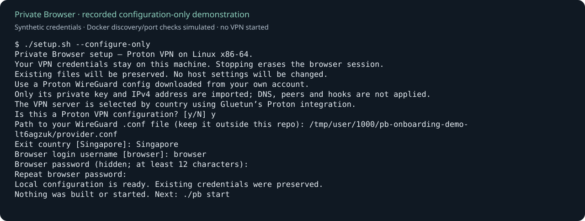

# Get started with Private Browser

The guided installer is an initial Linux x86-64 / Proton VPN path. Its onboarding
regressions are tested; a clean-machine real-VPN installation and an unfamiliar-user
trial are still pending. Windows, macOS, ARM, rootless Docker, remote Docker and
Docker Desktop are not part of this initial path. See [validation](VALIDATION.md).

Private Browser runs a separate Firefox through a VPN. Your normal browser and
other applications keep using their normal connections. This provides privacy,
not anonymity. Read the [privacy boundary](README.md#what-it-does-and-doesnt-do).

## Before you start

You need:

- A Linux x86-64 machine with a local rootful Docker Engine, Compose v2 or newer,
  Python 3.10 or newer, Bash, curl, readlink and timeout.
- Access to Docker from your normal user account and a working `/dev/net/tun`.
  Follow [Docker's official installation guide](https://docs.docker.com/engine/install/)
  and [Linux post-installation instructions](https://docs.docker.com/engine/install/linux-postinstall/).
  Docker access grants substantial control over the host; setup does not change
  groups, install software, enable services or change host permissions for you.
- Git to obtain the source (or download and extract the repository ZIP).
- Your own Proton VPN WireGuard `.conf` file with an IPv4 interface address,
  downloaded from your provider account. Store it **outside this repository**.
  Do not share it, paste it into chat, or use the same configuration for a second
  simultaneous VPN connection. Other providers use the [manual guide](README.md#manual-setup).

The wizard uses an installed `htpasswd` to create your login. If it is unavailable,
it offers the same operation through an automatically downloaded, digest-pinned
Docker Official Image without network access or host mounts during hashing.
On Debian/Ubuntu-family systems, installing `apache2-utils` provides `htpasswd`.

## Install from source

In a terminal, copy and paste:

```bash
git clone https://github.com/silverfox-2096/private-browser.git
cd private-browser
./setup.sh
```

These instructions work after the onboarding change is merged. Before then,
contributors must check out the adoption pull request; see [the plan](ADOPTION-PLAN.md).
No versioned installer or prebuilt release is published by these instructions.

The wizard asks whether the file is from Proton, where it is saved, your exit
country, and the username/password you want for the browser. Enter the file's path
without adding shell quotes; paths containing spaces are supported. Passwords
are hidden, must match, need at least 12 characters, and have a 72-byte limit.

Only the private key and IPv4 address are imported. Gluetun chooses the Proton
server by country; the imported file's endpoint, DNS and other options are not
applied. Configurations containing hooks or unsupported options are rejected.
Nothing in the provider file is executed. The source file stays where you put it.

The internal VPN API key is generated for you. It is separate from your provider
key and browser login; there is no key to obtain from another service.

You can save configuration without starting anything:

```bash
./setup.sh --configure-only
```

Setup saves `.env` and `webauth-htpasswd` locally with private permissions. Keep
both private: `.env` contains the VPN private key and an internal API credential;
the login file contains a bcrypt hash. Neither belongs in Git, screenshots,
support reports or an image build. Rerunning setup preserves existing credentials.
If setup is interrupted after one file is saved, rerun it to complete the other.
Malformed or unexpectedly writable files are preserved and require local review.

The first source build downloads and compiles dependencies. Duration, disk and
memory requirements have **not yet been measured on a clean machine**. Subsequent
starts reuse built images. A failed download/build does not erase your credentials;
resolve the cause and rerun. Readiness or missing evidence never counts as success.

## Open and log in

When setup prints `READY`, open **https://127.0.0.1:7814** and enter the browser
username/password you selected. The browser opens automatically when the desktop
supports it; otherwise use the URL shown in the terminal.

The default local HTTPS certificate is self-signed, so your browser may show a
certificate warning. Confirm that the address is exactly the local URL above
before choosing whether to continue. Never disable certificate checks globally.
Certificate warnings on other sites are unrelated to this installation.

`READY` means VPN health, browser response and the maintained local-app firewall
check passed. It is not a substitute for real-VPN leak testing. Before your first
browsing session, run `./pb verify`, then perform the separate browser WebRTC and
DNS checks described in [verification](README.md#verify-it-works). Verification
briefly stops the VPN and restarts Firefox: save work and close the viewer first.

## Everyday commands

Run commands from your installation folder:

| Command | What happens |
|---|---|
| `./pb start` | Build if absent, start the stack, check readiness/policy, open the login page. |
| `./pb status` | Show observed container state; does not start or restart anything. |
| `./pb doctor` | Read-only checks with hidden credential contents and actionable errors. |
| `./pb stop` | Ask, then stop the stack and erase the browser session. |
| `./pb update` | Ask, then run the maintained disruptive Firefox update and its checks. |
| `./pb verify` | Ask, then run the maintained disruptive network verification. |

**Stopping erases bookmarks, logins, cookies, history and downloads.** Save anything
you need somewhere outside the browser before stopping. Your VPN configuration
and browser login survive so that you can start again. Closing only the viewer
window is different from stopping the stack. Host-side viewer/clipboard traces
are outside the browser profile's RAM-only promise.

## Prebuilt release preview

A local prebuilt-bundle path is implemented, but real installation/update/rollback
acceptance and publication are still pending. There is no published release to
download yet. Once a reviewed release is available, use its matching source and
`./setup.sh --release /absolute/path/to/bundle`. Existing credentials are preserved.
Pinned installations update with `./pb update --release /absolute/path/to/bundle`
and can use `./pb rollback` after saving work and closing the viewer. Source
installations continue using the commands above. See [release limits and recovery](RELEASING.md#guided-prebuilt-installation-updates-and-rollback).

## If something goes wrong

- **Docker cannot be reached:** start Docker and verify that your normal account
  can access it. Use the official Docker guides above; do not run the entire
  wizard as root to work around a permissions problem.
- **A container belongs to another checkout or uses overrides:** use that
  installation's original commands. The wizard refuses to take over or restart
  it. The current fixed container names permit only one installation per engine.
- **An environment override is set:** open a clean terminal or unset the named
  variable. The wizard avoids inheriting a different daemon, Compose file,
  project or provider credential. It never prints the overridden value.
- **Port 7814 is occupied:** use the existing installation or close the application
  using that port. Setup does not silently change ports.
- **Existing files need review:** the wizard supports literal `.env` assignments
  for `WIREGUARD_PRIVATE_KEY`, `WIREGUARD_ADDRESSES`, `GLUETUN_API_KEY`,
  `VPN_SERVICE_PROVIDER` and `SERVER_COUNTRIES`. It supports one bcrypt login.
  Existing manual installations, special providers and Compose overrides should
  continue using the manual guide. There is no automatic credential reset.
- **Maintenance gate is active:** finish the operation that owns it. Follow the
  [maintenance recovery guide](README.md#maintenance-window); never blindly clear
  a gate while an update is running. For an interrupted release transition, close
  the viewer and use `./pb rollback` after any running command finishes; preserve
  the gate and transaction if recovery remains INCOMPLETE.
- **VPN readiness or policy did not pass:** avoid browsing; run `./pb doctor`.
  Check provider selection, country availability and whether the WireGuard config
  is valid and unused elsewhere. A healthy status alone is not a leak-test pass.
- **A lifecycle command was interrupted:** allow restoration to finish. Do not
  immediately launch another operation. The wrapper keeps its operation lock while child work continues and waits for
  existing recovery steps instead of killing a mutating command.

Doctor does not collect logs, resolved Compose configuration, IP addresses,
provider files, passwords or browser data. Share only its reviewed textual output.
For unresolved issues, use the repository's bug template; report vulnerabilities
privately as described in [SECURITY.md](SECURITY.md).

## Visual walkthrough and measured acceptance



This is a rendering of actual wizard prompts captured in a test harness. Its
credentials are synthetic, Docker discovery and port checks are simulated, and no
VPN was started. Replay the short [asciinema recording](assets/onboarding/setup.cast)
with `asciinema play assets/onboarding/setup.cast`, or read the
[plain transcript](assets/onboarding/setup-transcript.txt). Regenerate it with
`python3 ci/record-setup.py` on a Linux host with htpasswd and the TUN device.
The playback tool is optional and not required to install Private Browser.

Actual login/browser screenshots, a full real-VPN walkthrough, clean-machine
timing and first-time-user acceptance remain tracked in
[ADOPTION-PLAN.md](ADOPTION-PLAN.md). The local browser's self-signed certificate
warning requires a human to continue before UI capture. No mock image is
presented as a working VPN deployment.
